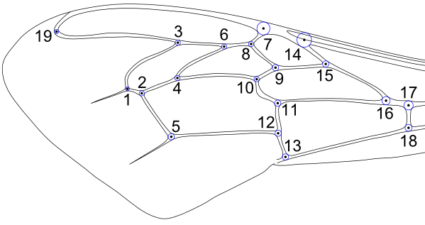
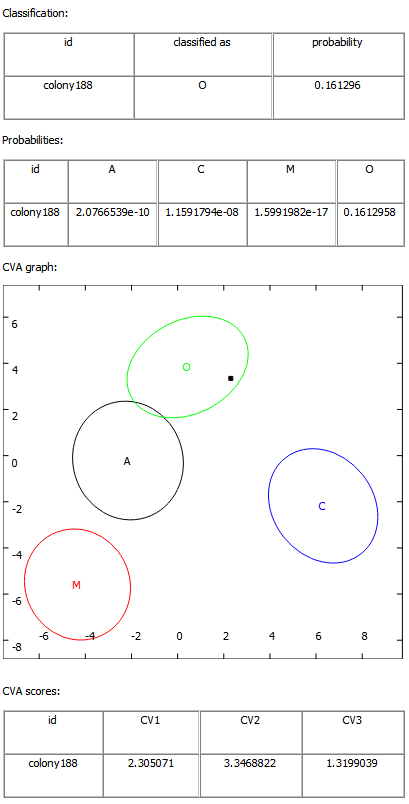

## Introudction

### About IdentiFly

IdentiFly is software for semiautomated classification based on geometric morphometrics. Primarily it was developed for identification of honey bee subspecies and insect species, but it can also be used for classification of any objects that differ in shape.

IdentiFly can be used as an alternative to tpsDig for digitizing landmarks and semilandmarks in two dimensions.

### Geometric morphometrics

Geometric morphometrics uses the configuration of landmarks to describe shape.

**Landmark**\
A landmark is a point corresponding to a particular part of an object in an image. It is described by its `x` and `y` coordinates.

**Configuration**\
A configuration of landmarks is a group of landmarks used to measure one object shown in one image. Landmarks in a configuration are numbered consecutively from one.

Two or more configurations are comparable when they have:

- the same number of landmarks, and
- the same biological/anatomical correspondence for each landmark number.

**Prototype**\

In IdentiFly, a prototype is an image containing a reference landmark configuration.

It is used:

- as a visual reference for manual landmark placement,
- by **Reset landmarks** and **Fit landmarks** operations (shape and size reference).

### License

IdentiFly is open-source software. It is distributed under the **GNU General Public License, Version 3 (GPL-3.0)**.

- Full license text: [LICENSE](../LICENSE)
- Project repository: <https://github.com/DrawWing/IdentiFly>

You are free to:

- use the software,
- study the source code,
- modify it,
- share copies (original or modified),

as long as distribution follows GPL-3.0 terms (including providing source code).

## Installation

IdentiFly binaries are available for Windows only.

- Download the ZIP file: [IdentiFly-2_0-win32.zip](https://github.com/DrawWing/IdentiFly/releases/download/v2.0.0/IdentiFly-2_0-win32.zip)
- Unzip the directory and copy it to your hard drive.
- Run `IdentiFly.exe`.

IdentiFly can be compiled for Linux and Mac. [Qt Creator](https://www.qt.io/development/tools/qt-creator-ide) can be used for this.

## Graphical user interface

Apart from the menu, toolbar and status bar, there is a space in the central part of the window where an image can be displayed using **Open**.

To add landmarks, click the image while IdentiFly is in **Add mode**. Landmarks can be deleted and moved in **Select mode** or **Drag mode**.

Landmarks are displayed as numbered red crosses. The crosses can be surrounded by a black or red circle. A red circle indicates a selected landmark.

A landmark can be selected:

- by clicking it (in Select mode or Drag mode),
- by drawing a selection rectangle around it (Select mode),
- by Ctrl+clicking multiple landmarks (Select mode or Drag mode),
- by rectangle-selecting multiple landmarks (Select mode).

In Add mode, landmark selection is not possible.

### Menu File

**Open**\
Open an image. Supported image formats: `*.png`, `*.bmp`, `*.tif`, `*.jpg`.

**Open directory**\
Display all DW.PNG images from a directory, sorted by file name.

**Open next file / Open previous file**\
Available after Open directory or Outliers, if a next/previous file exists.

**Save / Save as**\
Landmark data and additional information are stored together with the image in files with extension `.dw.png`.

- It is safe to view DW.PNG images in other software.
- Editing them in software not compatible with IdentiFly will likely destroy embedded metadata.

Landmark data can be read even if the extension is `.png`, but using the full `.dw.png` extension is recommended.

**Move to trash**\
Move the current image to directory `Trash` (created automatically if needed).

**Import TPS**\
Import landmark coordinates from TPS and save them in DW.PNG images listed in TPS. Only coordinates are imported (other data such as outlines are ignored).

**Export / Export directory**\
Export coordinates from current image or all DW.PNG images in a directory to TPS/CSV/TXT.

- TPS (importable by TPS and MorphoJ),
- CSV (importable by R, Excel and other spreadsheet software),
- TXT (importable by MorphoJ and R).

### Menu Mode

**Select mode**\
Select one or more landmarks; selected landmarks can be moved by drag-and-drop.

**Drag mode**\
Drag to pan the image; selecting/moving landmarks is also possible one-by-one.

**Add mode**\
Click image to add landmarks.

### Menu Edit

**Flip image vertically / horizontally**\
Mirror the currently displayed image.

**Rotate**\
Rotate the current image 90 degrees clockwise.

**Convert to grayscale**\
Convert the current image to grayscale.

**Crop**\
Crop the largest dark object after threshold adjustment (object of interest should be black on a white background).

### Menu View

**Data / Data from directory**\
View landmark coordinates from current image or all DW.PNG images in a directory.

**Zoom in / Zoom out**\
Change magnification.

**Zoom to actual size**\
Set magnification so one image pixel corresponds to one screen pixel.

**Zoom landmarks**\
Zoom so all landmarks are visible.

### Menu Landmarks

**Delete landmark**\
Delete selected landmarks.

**Reset**\
Load landmark configuration from the prototype file.

**Fit**\
Adjust landmark positions using the prototype; before fitting, at least first and last landmarks should be located by the user.

**Outliers**\
Detect measurements that differ from directory mean configuration. Differences are marked with yellow lines. Files are ordered from most to least different.

### Menu Semilandmarks

**Longest outline**\
Select a threshold to create a black-and-white image from which the outlines of all black regions are extracted as chains of connected pixels. The longest outline is assumed to correspond to the object of interest, which is marked in red.

**Semilandmarks 1 point**\
In an image with an outline and at least one landmark, select the number of semilandmarks. The semilandmarks will be marked around the pixel outline, beginning with the pixel closest to the first landmark.

**Semilandmarks 2 points**\
In an image with an outline and at least two landmarks, select the number of semilandmarks. The semilandmarks will then be marked on the pixel outline, starting with the pixel closest to the first landmark and ending with the pixel closest to the second landmark.

**Align semilandmarks**\
Select a directory that contains images with outlines and semilandmarks. The semilandmarks in all files will be corrected by sliding along the pixel outline and saved in a new directory. The name of the new directory starts with the name of the selected directory followed by "-aligned." 

**Longest outline - directory**\
The same as Longest outline but for all dw.png files in directory.

**Semilandmarks 2 points - directory**\
The same as Semilandmarks 2 points but for all dw.png files in directory.

### Scale

**Set scale bar**\
Define metric distance corresponding to scale bar. Last two landmarks are converted to scale bar.

**Clear scale bar**\
Remove scale bar information.

**Set resolution**\
Set image resolution in pixels per meter.

**Set resolution to directory**\
Set resolution for all images in a directory.

**Scale information**\
Display scale bar and resolution information.

### Menu Classification

**Set classification**\
Choose classification file (`.dw.xml`) that contains identification information and prototype info.

**View prototype**\
Open a window with prototype image. Use `Ctrl + Up` and `Ctrl + Down` for zoom in/out.

**Classify**\
Classify one image by its landmark configuration (landmark count must match prototype).

**Classify directory**\
Classify a directory using the average configuration from all images in that directory.

### Menu Help

**About IdentiFly**\
Display version and help website information.

## Identification of honey bee lineages 

In honey bee there are more than 20 subspecies (geographic races), grouped into four evolutionary lineages.

Before classifying a colony:

1.  Obtain forewing images of at least ten workers from the colony.
2.  Store images from different colonies in separate directories.
3.  Measure each wing.
4.  For honey bees, place 19 landmarks at corresponding venation positions.

Landmarks should be positioned so that guide circles are tangent to venation outlines in at least three points.

### Recommended procedure

- Use **Mode -\> Add landmarks** to place points.
- Zoom in and verify each landmark.
- Use **Mode -\> Edit landmarks** (drag-and-drop) to correct positions.
- Save with **File -\> Save**.
- Choose classification file with **Classification -\> Set classification**.
- For honey bee lineages use `Apis_mellifera_lineages.dw.xml`.
- Use **Classification -\> View prototype** as placement reference.
- After all colony wings are measured, run **Classification -\> Classify directory**.

Classifying a single wing (**Classification -\> Classify**) is possible but less reliable than directory/colony classification.

### Interpretation of classification

Probability values range from 0 to 1.

- High value for one group and low for others: strong assignment.
- Elevated values for multiple groups: possible hybrid/intermediate profile.
- Low values for all groups: doubtful assignment (measurement issue or sample not represented in model).

Common causes of doubtful output:

- landmark placement errors (especially swapped landmarks),
- focal colony outside model coverage (for example not included subspecies),
- non-*A. mellifera* sample.

Use **Landmarks -\> Outliers** to help detect landmarking errors.

The software also presents a CVA graph:

- colony shown as black marker,
- classes shown as ellipses,
- closer to ellipse center generally means higher similarity.

Interpret graph carefully: there are often more canonical dimensions than the two shown.

### Example: colony from Cyprus

Using `Apis_mellifera_lineages.dw.xml`:

The colony was classified as lineage O with probability 0.16, much higher than A, C, and M (2.0x10^-9^, 1.1x10^-8^, 1.5x10^-17^, respectively).
